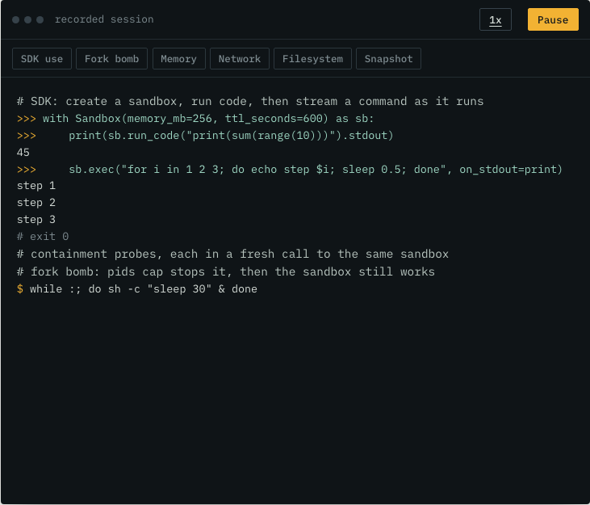
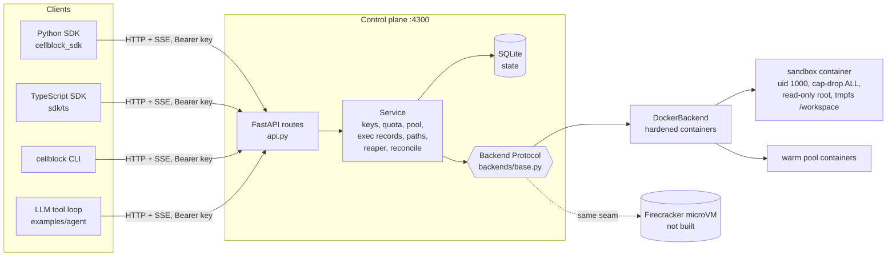

# cellblock

[](https://github.com/codealisha99/cellblock/actions/workflows/ci.yml)

Code-execution sandboxes for AI agents: an HTTP control plane (port **4300**) that creates hardened
containers on demand, runs commands and code with streamed output, moves files in and out, snapshots
workspaces into reusable templates, and reaps everything that is abandoned. Ships with a Python SDK,
a TypeScript SDK, a small admin CLI, and a scripted LLM tool-use example.

The hard parts: making exec **containable and killable** (a fork bomb must not wedge the sandbox, and a
timeout must take the grandchildren with it), keeping **SQLite and Docker in agreement** across crashes,
and getting **warm create** down to a row update while cold create stays honest about its cost.

**Landing page:** https://cellblock-site.vercel.app (recorded run, latency, limits, SDK snippets)



**Live demo:** none. The control plane needs a Docker daemon, and it must not run visitors' code on shared-kernel
containers. Run it locally with the quickstart below.



## Quickstart

Keyless demo first. It needs only Docker running and `uv`. It starts the server on :4300 with an
isolated home, runs the agent example through the SDK, prints cold vs warm create latency, and cleans up.

```bash
make install        # uv sync (Python 3.12) + pnpm install (TS SDK)
make demo           # keyless end-to-end run
make test           # 62 Python tests (unit + real-Docker integration)
make test-ts        # 5 TypeScript SDK tests (starts its own server on :4300)
make record         # re-record site/data from a real Docker run (landing page evidence)
```

Running the server yourself:

```bash
uv run cellblock key create me            # prints the API key once
export CELLBLOCK_URL=http://127.0.0.1:4300 CELLBLOCK_API_KEY=cb_...
uv run cellblock serve                     # in another terminal
uv run cellblock ls
uv run cellblock exec sbx_... "python3 -c 'print(1+1)'"
uv run cellblock logs sbx_...
uv run cellblock rm sbx_...
```

With a real model (not run in this build, see Limitations):

```bash
ANTHROPIC_API_KEY=... uv run --extra examples python -m examples.agent.run
# CELLBLOCK_MODEL overrides the model; default is claude-sonnet-5-5
```

### Python SDK

```python
from cellblock_sdk import Sandbox

with Sandbox(memory_mb=256, ttl_seconds=600) as sb:
    print(sb.run_code("print(sum(range(10)))").stdout)           # "45\n"
    sb.exec("pip --version", on_stdout=print)                    # streams as it arrives
    sb.files.write("app/main.py", "print('hi')")
    template = sb.snapshot("with-app")                           # save /workspace
with Sandbox(snapshot_id=template["id"]) as sb2:                 # restored files are present
    print(sb2.files.read_text("app/main.py"))
```

### TypeScript SDK

```ts
import { Sandbox } from "./sdk/ts/src/index.ts";

const sb = await Sandbox.create({ memoryMb: 256 });
await sb.runCode("print('hi')", { onStdout: (chunk) => process.stdout.write(chunk) });
await sb.delete();
```

## API (all under `/v1`, `Authorization: Bearer <key>`)

| Method | Path | Purpose |
|---|---|---|
| POST | `/sandboxes` | create (`image` must be in `CELLBLOCK_ALLOWED_IMAGES`, `snapshot_id`, `cpu`, `memory_mb`, `pids`, `network`, `workspace_mb`, `ttl_seconds`) |
| GET / GET / DELETE | `/sandboxes[/{id}]` | list, get, destroy |
| POST | `/sandboxes/{id}/pause`, `/resume` | freeze / thaw |
| POST | `/sandboxes/{id}/exec` | run argv or a shell string, JSON result (each stream capped at 16 MiB, `truncated` flags a cut) |
| POST | `/sandboxes/{id}/exec/stream` | same, as SSE: `started`, `stdout`, `stderr`, `exit` |
| POST | `/sandboxes/{id}/code[/stream]` | run python or node snippet |
| POST | `/sandboxes/{id}/execs/{exec_id}/kill` | kill a running exec and its descendants |
| GET | `/sandboxes/{id}/execs` | exec history with capped output |
| GET / PUT | `/sandboxes/{id}/files?path=`, `/files/content?path=` | list, download (streamed), upload (raw body, max 100 MiB) |
| POST / GET / DELETE | `/sandboxes/{id}/snapshots`, `/templates[/{id}]` | snapshot workspace (streamed to disk), manage templates |
| GET | `/healthz` | liveness and warm-pool depth (no auth) |

Domain errors are `{"error": "..."}` with 400 (bad path or input), 401, 404 (also for other keys' sandboxes),
409 (wrong state, e.g. exec on a paused sandbox), 422 (image not in the allowlist), 429 (quota). Schema errors (422)
and unknown routes (404/405) come from FastAPI and use `{"detail": ...}` instead.

## How the hard parts are solved

- **Containable, killable exec.** Each exec runs as its own session via `setsid`. Its process-group id is
  written to a tmpfs file. A timeout uses `timeout(1)` inside the group. When the command ends, the wrapper
  SIGKILLs the whole group, so leftover grandchildren die too. Kill-from-API uses shell builtins only.
  This matters because a fork bomb exhausts the pids cgroup, and any helper that needs `fork` (`grep`, `cat`)
  then fails. A `docker exec` cannot even start. That exact failure was found by a test and fixed this way.
- **Files without a host escape.** Paths are normalized on the host and `..` is rejected outright. Then the
  *symlink-resolved* path is re-checked inside the container (`realpath -m`) before any read or write.
  Writes go through `exec` with stdin, not `put_archive`, because Docker's archive API cannot see tmpfs mounts.
- **Warm pool.** Pooled containers are pre-started default-profile sandboxes, recorded in SQLite as `pooled`
  only after they are running. A default create claims one by updating its row. Unclaimed pool containers are
  removed on shutdown, and shutdown waits for any in-flight refill (a race found by the demo leaving containers
  behind).
- **Reconciliation.** On startup, SQLite and Docker are compared. Containers with no live row are removed as
  orphans. Rows whose container vanished or died are marked `lost` and free their quota. Running sandboxes
  survive a control-plane restart. Docker ownership is scoped by an `instance` label, so two control planes on
  one host never kill each other's containers.
- **Quota.** Count and reservation happen under one lock. The row is reserved as `creating` before the slow
  Docker call, so concurrent creates cannot overshoot the limit.

## Measured latency

From `scripts/record_session.py` (Docker Desktop 29.7.2 on an M-series Mac, `python:3.12-slim` cached, warm
pool of 4, 20 samples each, measured client-side around the SDK call; raw values in `site/data/latency.json`):

| Path | Median | Min | Max | Samples |
|---|---|---|---|---|
| cold (`cpu=0.5`, off the pooled profile, so it can't claim a warm container) | 222.1 ms | 186.4 ms | 369.4 ms | 20 |
| warm (default profile, claimed from the pool) | 3.5 ms | 2.2 ms | 7.6 ms | 20 |

Warm is about 63x faster at the median. Note what warm does not include: the warm path is a DB update, so it does not
measure the first exec's latency or the cost of replenishing the pool in the background. `make demo` prints the same
comparison with 3 samples.

## Isolation: what this is and what it is not

The isolation backend is **hardened Docker containers**. Firecracker needs KVM, which this Mac does not
have, so it is not built. `backends/base.py` defines the `Backend` Protocol, and a Firecracker backend would
implement the same methods. Nothing above the seam changes.

Hardening applied to every sandbox:

- non-root uid 1000, `cap-drop ALL`, `no-new-privileges`, Docker's default seccomp profile
- read-only root filesystem; `/workspace` is a size-limited tmpfs (`noexec` on `/tmp`)
- memory limit with swap disabled, CPU quota, pids limit, `nofile` ulimit
- `--init` so orphaned grandchildren get reaped rather than eating the pids budget
- network `none` unless requested; no Docker socket mounted

What this **does** protect against, verified by tests: a command reading or writing outside the
workspace (writes to `/etc` and `/usr` fail); memory exhaustion (the process is OOM-killed, the sandbox
survives); fork bombs (the pids cap stops them, and the sandbox recovers); network access when disabled;
writing past the workspace size; path traversal and symlink escape through the file API; a timeout that
leaves children running.

What it **does not** protect against:

- **Kernel exploits.** All containers share the host kernel (here, the Linux VM inside Docker Desktop). A kernel
  bug is a sandbox escape. Untrusted code in production needs a microVM (Firecracker, Kata) or gVisor.
- **Network egress control.** `network=true` is a bridge with full outbound access. There is no allowlist, no
  DNS policy, and no metadata-endpoint blocking.
- **Side channels and noisy neighbours.** CPU and cache timing, and host disk I/O, are shared.
- **The control plane is reachable from `network=true` sandboxes by IP.** `host.docker.internal` and
  `gateway.docker.internal` are pinned to the container's own loopback, so the name no longer reaches the host
  (tested). The host's bridge gateway IP still does, and so does any other host service bound to it. Every
  endpoint needs a valid key, but do not run untrusted code with networking unless you accept that the host
  network is reachable from it. Closing that needs a firewall rule, which this project does not manage.
- **Processes that leave the process group.** A process that calls `setsid`/double-forks escapes the group reap.
  It stays inside the memory and pids limits, and it dies when the sandbox is deleted.
- **Symlink races.** The file-path check is a time-of-check. The container user could swap a symlink between
  the check and the operation. The impact is limited to what that user can already read inside its own
  container, but the path policy is advisory. The container boundary is the real one.

## Design decisions and trade-offs

- **SQLite plus a Protocol, not a service mesh.** One process, one file of state. It is single-node by design.
- **Sync Docker calls on threads.** `docker-py` is blocking. FastAPI runs the sync routes in a threadpool,
  and the lock keeps quota and pool claims consistent.
- **Exec recording keeps only the first 64 KB per stream** for `logs`. Live streaming is never truncated.
- **Snapshots cover `/workspace` only.** Changes to the root filesystem (`pip install` into system site-packages)
  are not captured. The snapshot tarball sits unencrypted on local disk.
- **API keys are stored as SHA-256 hashes.** There is no expiry or rotation yet.
- **Default model is `claude-sonnet-5-5`,** set by the project build rules and overridable with
  `CELLBLOCK_MODEL`.

## Limitations and next steps

- **The live-model path is not exercised.** The build environment has no Anthropic API key, so
  `examples/agent/model.py` has only been checked to construct the client and pick the model. The keyless demo
  and its tests use the scripted model.
- **No Firecracker backend.** This needs a KVM host (Linux). The seam is ready for it.
- **`run_code` with `language="node"` needs a node image.** The default image is Python-only. `node:22-alpine` is
  on the allowlist and has a test (`test_run_code_node_on_node_image`).
- **The CLI has no automated tests.** Its `ls`, `exec`, `logs`, and `rm` were verified with a manual smoke run
  against a live server (exit-code propagation included). No coverage figure is claimed; the suite has no coverage
  tooling configured.
- **A client disconnect does not kill the exec.** It runs until its timeout. Killing on disconnect is a few lines.
- **No rate limiting, no TLS.** Put it behind a reverse proxy.
- **Pause does not release memory,** and the warm pool serves only the default profile.
- **Templates have no per-key disk quota.** Snapshots and restores stream through 64 KiB chunks, so memory stays
  flat, but a template is bounded only by the sandbox's `workspace_mb` (2 GiB maximum).
- **Images are allowlisted.** Only images in `CELLBLOCK_ALLOWED_IMAGES` (default `python:3.12-slim`, `node:22-alpine`)
  can be created; others get 422. The allowlist is a name check; it does not pin digests.
- **Single-node.** No multi-host scheduling, no persistence of exec output beyond 64 KB, no metrics endpoint.
- **TS SDK is not published.** Tests run on Node type stripping; `pnpm typecheck` passes.
